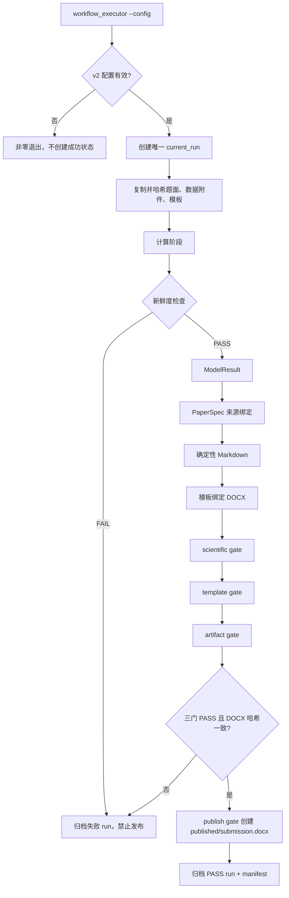

# Forge v8 P0 可信建模生产系统

## 改造结论

Forge v8 P0 把“脚本跑完”改成“同一 run 内证据闭环后才可发布”。生产状态不再由字符串或文件存在性决定，而由阶段退出码、输入输出哈希、新鲜度、内容一致性和发布证明共同决定。

## 核心不变量

1. 唯一生产入口是 `core/runtime/workflow_executor.py --config <workflow.json>`；配置缺失或不是 v2 时退出非零。
2. 每轮创建唯一 `run_id`，运行期间只有 `runtime/runs/current_run/` 可读写生产数据；结束后原子归档为 `runtime/runs/<run_id>/`。
3. 源输入采用目录白名单（项目 `task_assets/`、`source_inputs/`；声明模板目录），阶段参数采用严格 `--flag value` 语法且路径必须使用当前 run token。旧 run 不能成为输入，声明输出在阶段开始前存在时立即失败。
4. 阶段成功等于：退出码为零、所有输出存在、输出时间属于该阶段、输出 SHA-256 已登记、freshness GateResult 为 PASS。
5. 论文事实链固定为 `ModelResult → PaperSpec → Markdown/DOCX`。人类草稿和计算脚本均不能直接成为生产论文事实源。
6. 科学、模板、制品三个门禁必须记录所检查 DOCX 的哈希；发布门禁要求三份证明与待发布文件哈希完全相同。
7. `artifacts/submission.docx` 是不可交付中间文件；只有 `artifacts/published/submission.docx` 是生产交付物。
8. v2 配置必须包含完整可信链并保持顺序；论文构建与四个生产门禁必须指向仓库内的 canonical scripts，不能用同名伪 PASS 脚本替代。
9. 每个可信阶段产出后立即验证 ModelResult/PaperSpec/GateResult 的 schema 与当前 `run_id`；活跃锁按主机和进程核验，崩溃遗留的同主机死锁会被隔离留证。
10. 可信论文链使用固定 canonical 参数，requires/produces 必须与参数逐文件绑定，禁止无法穷举产物的 `--output-dir`；配置、stage 目录中的源码/字节码/扩展模块和可信模块在启动时登记 SHA-256，并在每阶段前后执行 code-integrity gate。
11. 配置的第三方 `python_paths` 仅供原始计算阶段使用，不进入 ModelResult、PaperSpec、论文编译、内容门禁或发布阶段。

## Run 目录

```text
runtime/runs/<run_id>/
├── inputs/       # 从声明源复制并登记哈希的只读语义输入
├── artifacts/    # 本轮计算、图、ModelResult、PaperSpec、论文和发布稿
├── logs/         # 每阶段 UTF-8 stdout/stderr
├── gates/        # freshness 与内容 GateResult
└── manifest.json # 配置、输入、阶段、时间、哈希和最终状态
```

## 新执行流程



## GateResult 统一结构

所有生产门禁均返回 `forge-gate-result/v1`，包含 `run_id`、`gate`、`status`、逐项 `checks` 和结构化 `errors`。PASS 由空错误集合推导，不允许手写占位 PASS。

## 科学门禁覆盖

- PaperSpec 的 run、problem 和 ModelResult SHA 来源一致；
- Markdown 必须是 PaperSpec 的确定性渲染；
- DOCX 中的绑定结论、所有数字、排名表和参数表与 ModelResult 一致；
- 页眉只能出现绑定标题，页脚只能保留页码域；评论、脚注、尾注、文本框和浮动对象不能夹带未绑定结论；
- 排名顺序、样本量、评价指标范围合理；
- 显著性和数据泄漏诊断必须给出 PASS 或有理由的 NOT_APPLICABLE；
- 门禁检查后若 DOCX 被修改，发布门禁通过哈希证明拒绝发布。

## 回滚边界

旧执行器、v1 配置和固定路径论文生成器保存在 `core/runtime/legacy/` 并标注 `NOT FOR PRODUCTION`，用于审计和人工回滚参考，不由 v8 入口导入。v8 改造主要采用新增文件和显式配置升级，没有删除历史项目结果。

## 验收证据

- `tests/v8` 当前包含四十一项行为测试，覆盖任务要求的四项验收，以及参数语法绕行、开放输出目录、alternate 产物、配置/源码/字节码篡改、Python shadow path、输入改名、伪 GateResult、并发与残留锁、页眉/OOXML/VML 夹带、表格错位/边框、图片替换和未绑定文字等扩展攻击面。
- 最新参考执行 `20260903T161024245929Z-6f90e73277`：十二个生产 stage 全部 PASS，十八份 freshness/content/code-integrity gate 报告全部 PASS，五十九个配置/源码/字节码/扩展模块文件登记 SHA-256，复算哈希无差异，所有声明输出均有 SHA-256。
- 发布 DOCX SHA-256 为 `c9d80313c0003a8965f3f30d52842470b00a494957988b55ba8afc3a2647d705`；ZIP 无损坏，含一个 section、十四个非空正文段落、两个表格、五幅 inline 图，页眉仅含绑定标题且页脚无可见自由文本。
- 页面渲染已尝试，但本机没有 LibreOffice/soffice，因此没有把视觉逐页检查伪报为 PASS。

## 本阶段不包含

Project Initializer、自动题目解析、自动模型规划、通用模板契约、OMML 和 PDF 终审链不属于 P0，避免在可信性基础尚未稳定时扩展模型能力。

## 当前剩余风险

- 路径隔离由执行器和参数契约实施，不是操作系统沙箱；恶意或被篡改的模型脚本仍可能主动读取未声明文件。
- 输入和产物有 SHA-256，但当前没有外部签名、可信时间戳或只读对象存储，不能抵御拥有本机写权限的对手。
- 科学门禁覆盖来源一致性和基础统计合理性，不替代领域专家对模型假设、显著性方案和结论边界的审稿。
- 当前 CUMCM DOCX 是 contract-derived bootstrap 模板，不是官方比赛模板。
- 本机缺少 LibreOffice 页面渲染器；已完成 DOCX ZIP、段落、表格、图片和门禁结构检查，但逐页视觉 QA 留到后续终审链。
- S2/S5 人工确认和 S7 评分闭环属于后续治理范围，未加入本阶段生产 PASS 的合取条件。
