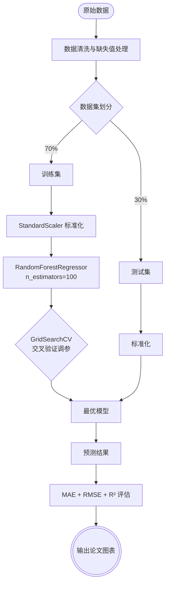
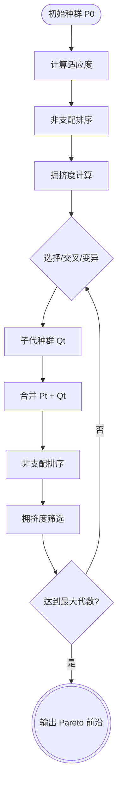
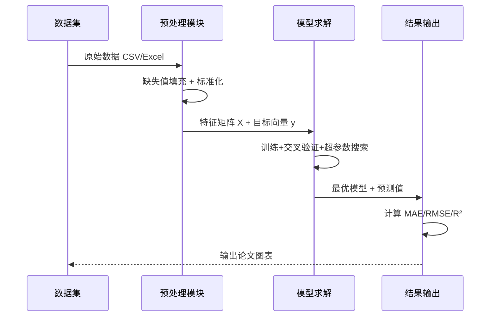
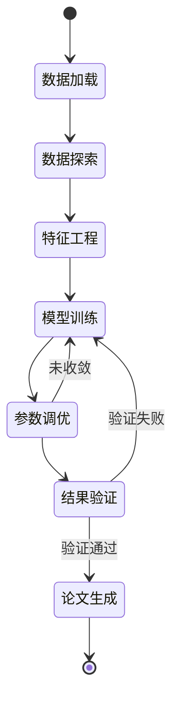
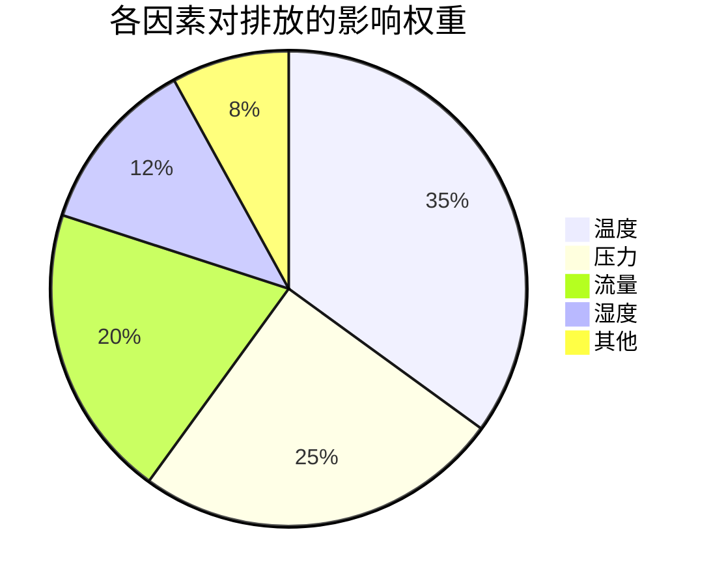
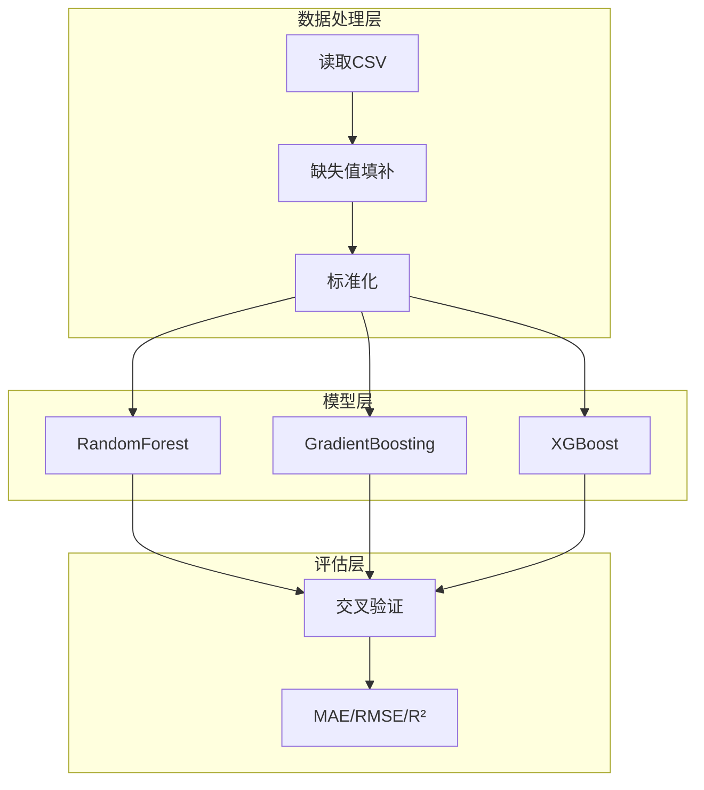
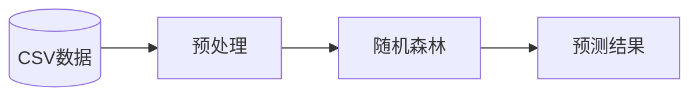

# Mermaid 完整参考 — 数模论文模型框架图

> 来源：mermaid-js/mermaid（GitHub ~89k stars, MIT）
> 蒸馏自官方 README + Flowchart 语法文档
> 服务于 S6 (PAPER) 模型框架图/算法流程图/时序图自动生成

---

## 一、Mermaid 定位

```
基于文本的图表生成工具
"写代码 → 出图" 而非 "拖拽画图"
```

**数模核心价值**：
- 模型框架图、算法流程图、问题分解图 → 论文第一节必配
- 文本形式存在，Git 可版本控制，diff 清晰
- GitHub/GitLab Markdown **原生渲染**（代码块直接显示为图）
- 支持导出 PNG/SVG/PDF

---

## 二、快速上手

在线编辑器：[mermaid.live](https://mermaid.live) — 左边写代码，右边实时预览

```markdown
\`\`\`mermaid
flowchart LR
    A[输入数据] --> B[预处理]
    B --> C[模型求解]
    C --> D[结果输出]
\`\`\`
```

> 上面的代码块在 GitHub/GitLab 中直接渲染为流程图

---

## 三、数模最常用的四种图

### 3.1 流程图 (flowchart) — 模型框架图（最核心）

#### 节点形状速查

| 形状 | 语法 | 数模用途 |
|------|------|----------|
| 矩形 | `A[文本]` | 处理步骤 |
| 圆角 | `A(文本)` | 事件/输入 |
| 体育场 | `A([文本])` | 开始/结束 |
| 菱形 | `A{文本}` | 判断分支 |
| 圆柱 | `A[(文本)]` | 数据集/数据库 |
| 六边形 | `A{{文本}}` | 前置条件 |
| 圆形 | `A((文本))` | 起始点 |
| 双圆 | `A(((文本)))` | 终止点 |
| 平行四边形 | `A[/文本/]` | 输入/输出数据 |
| 子程序 | `A[[文本]]` | 子模型/子流程 |

#### 箭头类型

| 语法 | 效果 |
|------|------|
| `A --> B` | 实线箭头 |
| `A --- B` | 实线无箭头 |
| `A -.-> B` | 虚线箭头 |
| `A ==> B` | 粗线箭头 |
| `A -->\|标签\| B` | 带文字箭头 |

#### 数模实例：预测模型框架图



#### 数模实例：NSGA-II 算法流程



### 3.2 时序图 (sequenceDiagram) — 系统交互/算法步骤



### 3.3 状态图 (stateDiagram) — 模型状态转移



### 3.4 饼图 (pie) — 构成比例



---

## 四、分组 (subgraph) — 模块化组织



---

## 五、导出图片（用于论文）

### 方法一：在线编辑器导出
- 打开 [mermaid.live](https://mermaid.live)
- 粘贴代码 → 自动渲染 → 点击导出 PNG/SVG

### 方法二：命令行工具

```bash
# 安装 mermaid-cli
npm install -g @mermaid-js/mermaid-cli

# 将 .mmd 文件导出为图片
mmdc -i flowchart.mmd -o flowchart.png -t neutral --scale 2
# -t: 主题 (default/neutral/dark/forest)
# --scale: 缩放倍数
```

### 方法三：VSCode 插件
- 安装 "Markdown Preview Mermaid Support"
- Markdown 中 `\`\`\`mermaid` 代码块自动渲染
- 右键导出 PNG

---

## 六、在论文 Word/LaTeX 中插入

1. 在 mermaid.live 导出 SVG
2. 插入到论文文档中
3. SVG 矢量格式 → 无限缩放不失真

**LaTeX 建议**：导出为 SVG 再通过 Inkscape 转 PDF → `\includegraphics{flowchart.pdf}`

---

## 七、GitHub/GitLab 自动渲染

在项目 README.md 或 Jupyter Notebook 中：

````markdown
## 模型框架图


````

在 GitHub 页面直接看到渲染后的图，无需额外工具。

---

## 八、常见坑位

| 坑 | 现象 | 解决 |
|----|------|------|
| 节点文本有 `"` | 语法报错 | 不用引号或用中文引号代替 |
| 节点 `end` 关键字 | 流程图中断 | 改为 `End` 或 `END` |
| 节点首字母 `o` | 变为圆边 | 前面加空格或大写 |
| 特殊字符渲染 | 标签显示异常 | 用 `#quot;` `#35;` 等 HTML 实体 |
| mermaid-cli 报错 | 缺少依赖 | 确保有 puppeteer/chromium |
| 不支持的图表 | 语法正确但空白 | 检查 mermaid 版本（建议 ≥ 10.x） |
